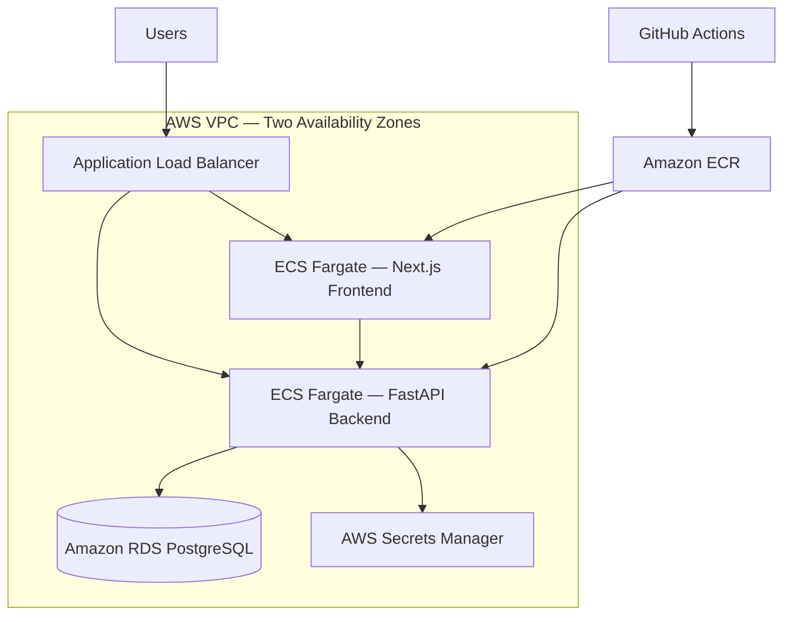
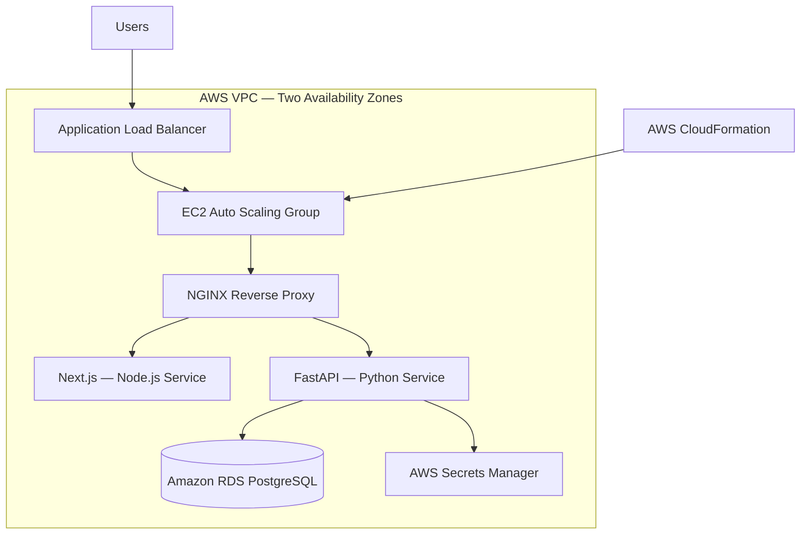

# AWS Deployment Architecture

This assessment provides two deployment approaches:
1. Containerized deployment using Amazon ECS Fargate.
2. Non-containerized deployment using Amazon EC2 Auto Scaling.

Both approaches use CloudFormation for infrastructure provisioning.

## 1. Containerized Architecture — ECS Fargate

**Network design:** The ALB is internet-facing in public subnets. ECS services and RDS run in private subnets. The NAT gateway provides outbound access where required.

## 2. Non-containerized Architecture — EC2

**Runtime design:** EC2 user data installs application dependencies and configures systemd services for Next.js and FastAPI. NGINX routes requests to the application services.

## 3. Deployment Environments

The CloudFormation templates are designed to support separate **dev**, **staging**, and **prod** deployments using environment-specific parameters and AWS resources.

## 4. CI/CD

- **GitHub Actions CI:** Validates backend Python syntax, builds the frontend, and validates CloudFormation templates.
- **GitHub Actions ECS deployment:** Builds and pushes application images to ECR and updates ECS services. Deployment is manually triggered until AWS credentials and resources are configured.
- **AWS-native pipeline:** A CodePipeline/CodeBuild CloudFormation template is included for backend container build and ECS deployment.

> These diagrams represent the intended deployment-ready architecture. AWS infrastructure has not been deployed or verified in a live account as part of this assessment.